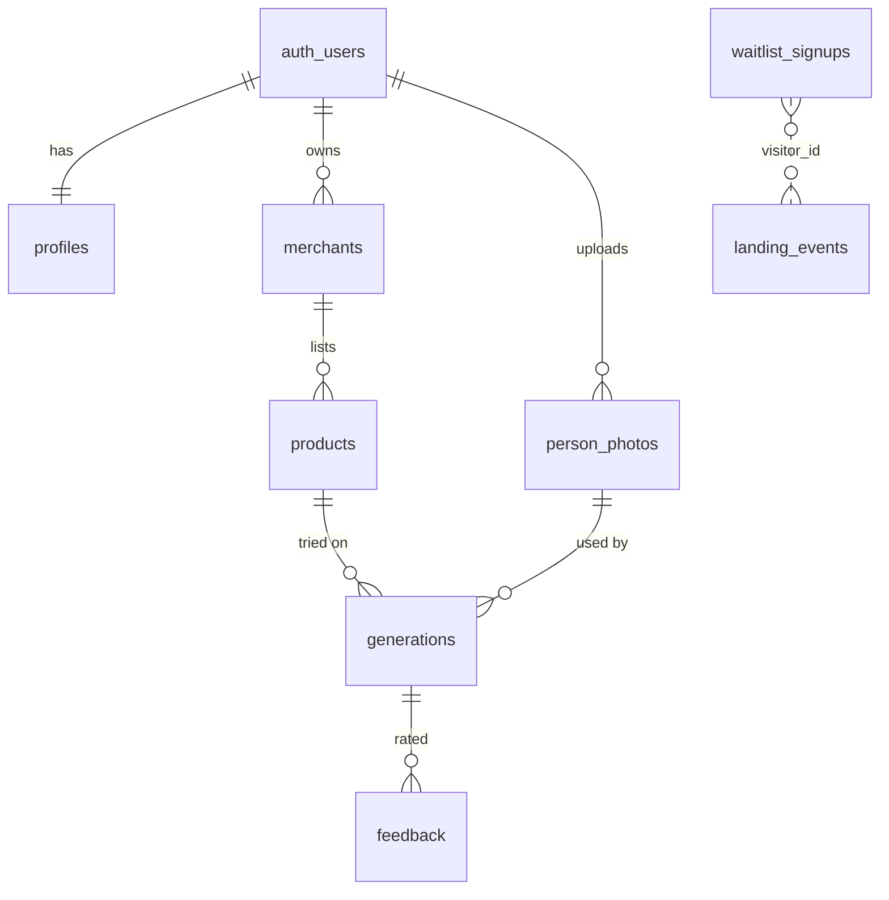

# Database Schema

Source of truth: [`app/supabase/migrations/0001_init.sql`](../app/supabase/migrations/0001_init.sql). Postgres on Supabase, with RLS enabled on **every** table.

## Tables

| Table | Purpose | Key columns | Who can read | Who can write |
|---|---|---|---|---|
| `profiles` | Role per user | `role` (shopper/merchant/admin) | self, admin | self (role changes blocked by trigger unless admin or service role) |
| `merchants` | Tenant / retailer account | `plan`, `monthly_generation_quota`, `status` | owner, admin | owner |
| `products` | Garment catalog | `category`, `price_cents`, `purchase_url` (https only), `image_path` | public if active; owner | owner |
| `person_photos` | **Sensitive** shopper photos | `storage_path`, `consent_version`, `consented_at`, `expires_at` | **owner only** (no admin policy) | owner |
| `generations` | Try-on attempts **and** AI generation log | `provider`, `model`, `status`, `latency_ms`, `cost_usd`, `error_code`, `saved` | owner, admin | service role; owner may only toggle `saved` (trigger) |
| `feedback` | Satisfaction (1–5) | `rating`, `comment` | owner, admin | owner, for own generations |
| `waitlist_signups` | Merchant waitlist | `email` (unique), `platform`, `monthly_orders`, UTM | admin | service role (server route) |
| `landing_events` | First-party funnel events | `visitor_id`, `event`, `variant` | admin | service role |

## Views & functions

| Name | Purpose |
|---|---|
| `landing_conversion_daily` | Visitors, signups and conversion % per day (`security_invoker`, so admin-only through RLS) |
| `generation_stats_daily` | Attempts, success, completion %, median latency, cost, cost per success, per provider per day |
| `merchant_product_stats(merchant_id)` | Aggregate counts per product. Checks ownership. No personal data. |
| `is_admin()` | Helper for policies |

## Storage buckets

| Bucket | Public | Path convention | Policy |
|---|---|---|---|
| `person-photos` | No | `<user_id>/<uuid>.<ext>` | Owner read/write/delete via `storage.foldername(name)[1] = auth.uid()` |
| `tryon-results` | No | `<user_id>/<generation_id>.<ext>` | Owner read/delete; written by the server |
| `garments` | Yes (product imagery is marketing content) | `<merchant_owner_id>/<uuid>.<ext>` | Public read; owner write/delete |

Bucket-level `file_size_limit` and `allowed_mime_types` provide a second line of defense behind app validation.

## Retention & deletion

- `person_photos.expires_at` is set at upload. `/api/cron/purge` (daily) deletes expired photos and their results.
- Photo deletion removes derived results and nulls `generations.result_path`. Usage and cost rows remain, detached from personal data.
- Account deletion removes the storage folders, then `auth.users`. FKs cascade or `set null`.

## Evolution from the earlier prototype

The uploaded prototype (`schema.ts`, `schema_v2.sql`, MySQL/Drizzle) modeled many future concepts: provider health, quality evaluations, size charts, purchases, returns and pilot accounts. We deliberately **did not port** them into the MVP. They are good references for the Growth phase:

- `quality_evaluations`: adopt for the Week-3 benchmark rubric
- `purchases` / `returns` / `storefront_events`: adopt with the Shopify integration
- `pilot_accounts`: adopt when the waitlist converts to pilots
