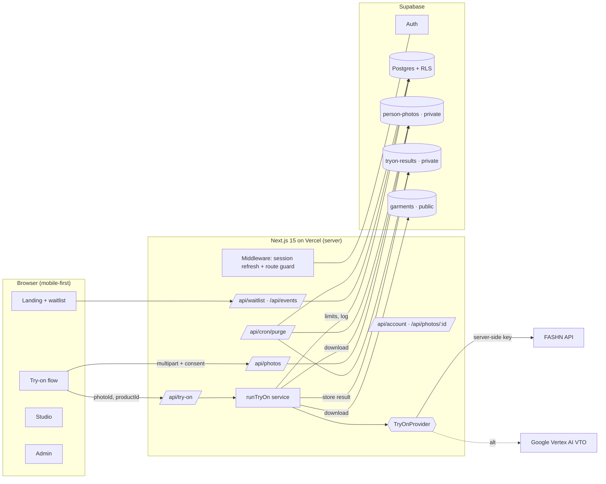
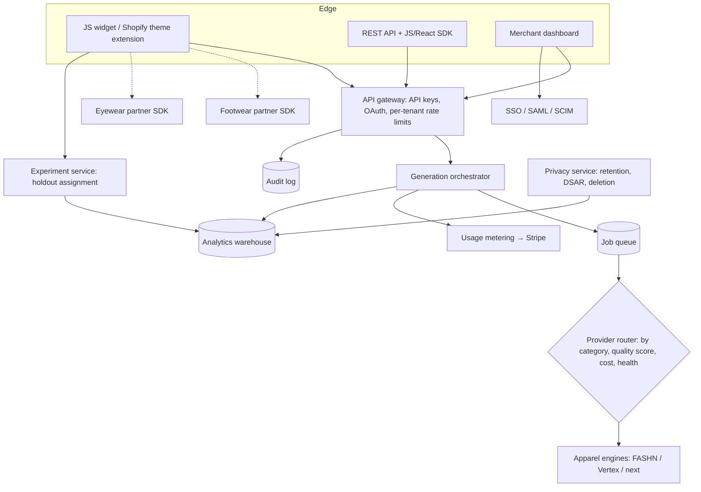

# Technical Architecture

## 1. MVP (built)



### Request flow: generate try-on

1. The browser POSTs `{photoId, productId}` to `/api/try-on`. The route checks same-origin and the session, and validates the payload with zod.
2. `runTryOn`:
   - checks the provider is configured, otherwise returns **503 with an honest message**
   - loads the photo (explicit `user_id` match) and the product
   - rejects expired, deleted, inactive or unsupported items
3. **Limits:** per-user per minute, per-user per day, and a global daily USD budget. Exceeding any returns `429` + `Retry-After`.
4. Inserts a `pending` generation row with the **reserved cost**. This counts toward limits during the call.
5. Downloads the person and garment bytes from Storage and calls `provider.generate()`.
6. Uploads the result to a private bucket, returns a **10-minute signed URL**, and completes the row with status, latency, cost and job ID.
7. **On failure:** the row is marked `failed` or `rejected` at cost $0, with an error code. The user sees a safe message, and the raw provider error stays in the log only.

### Provider abstraction

```ts
interface TryOnProvider {
  id: string; model: string;
  supportedCategories: readonly ("tops" | "bottoms" | "one-pieces")[];
  costPerImageUsd: number;
  generate(input: TryOnInput, signal?: AbortSignal): Promise<TryOnOutput>;
}
```

- `FashnProvider`: async `POST /v1/run`, then poll `GET /v1/status/:id`, with a 90s timeout. Maps moderation, input, 429 and 5xx errors to `ProviderError` codes.
- `VertexTryOnProvider`: synchronous `:predict` with base64 images and a Google access token (`google-auth-library`, service account or ADC). Watermark on.
- `createProvider(env)` returns **`null`** when unconfigured. There is deliberately no mock fallback in runtime code. Test doubles live only in `tests/`.
- **To add a vendor:** implement the interface, register it in `createProvider`, set `TRYON_PROVIDER`. Nothing else changes.

> ⚠️ Both adapters follow each vendor's public docs and pass contract tests against mocked HTTP, but **have not been run with live credentials in this environment**. The first task of Week 3 is a live smoke test with a real key.

### Security controls

| Control | Where |
|---|---|
| Row-level security on every table; owner-scoped storage paths | `0001_init.sql` |
| Server-only secrets (`SUPABASE_SERVICE_ROLE_KEY`, `FASHN_API_KEY`, Google creds); `server-only` import guard; build verified to contain no secret names in client chunks | `lib/supabase/server.ts`, `lib/providers/index.ts` |
| Magic-byte image validation, dimension checks, size caps (app + bucket) | `lib/image.ts`, bucket config |
| Same-origin check on all state-changing routes (CSRF mitigation alongside SameSite cookies) | `lib/http.ts` |
| Durable rate limits + global budget cap | `lib/limits.ts`, `SupabaseTryOnRepo.getUsage` |
| Users can only toggle `saved`; role escalation blocked | DB triggers |
| Security headers (nosniff, DENY framing, referrer, permissions) | `next.config.ts` |
| Honeypot + email uniqueness on waitlist; no list probing (duplicate returns 200) | `/api/waitlist` |
| Admins cannot access personal photos | No admin policy on `person_photos` / results |
| Retention purge protected by `CRON_SECRET` | `/api/cron/purge` |

**Known MVP limitations:**
- Rate-limit checks are check-then-insert, so a few concurrent requests can exceed the limit by one or two. Acceptable at pilot scale; move to an atomic RPC or Redis later.
- The global budget sums today's rows in the app. Move this to a SQL aggregate when volume grows.
- No CSP header yet (needs nonce support for Next inline scripts).

## 2. Target enterprise architecture (not built; design only)



| Capability | Design decision |
|---|---|
| Multi-tenancy | `organizations → stores → members(role)`. Every row carries `org_id`, with RLS on `org_id in (user's orgs)`. Shared database first, then dedicated schemas for enterprise if contracts require. |
| Widget | A `<script>` loader plus a sandboxed iframe on a TrendSet origin. Shopper photos never touch the merchant's domain. |
| Shopify | Theme app extension (app block on the PDP), Admin API product sync, `orders/create` webhook for attribution, Shopify Billing API. |
| WooCommerce | WordPress plugin wrapping the same widget, plus a REST product feed. |
| Orchestration | Queue-based (e.g. Supabase Queues/pgmq, Inngest or Cloud Tasks) for retries, timeouts and provider failover. The client polls or uses SSE. |
| Metering & billing | An append-only `usage_events` ledger; Stripe metered prices; quotas per plan; hard and soft caps. |
| A/B testing | Deterministic assignment `hash(visitor_id, experiment_id) % 100`, exposure logging, and order attribution through webhooks. See the pilot plan for the analysis method. |
| Auditability | An immutable audit table for admin and merchant actions; export to SIEM. |
| Enterprise auth | Supabase SSO (SAML) or WorkOS when the first enterprise deal needs it. |
| Observability | OpenTelemetry traces, Sentry, provider health dashboards, cost alerts. |
