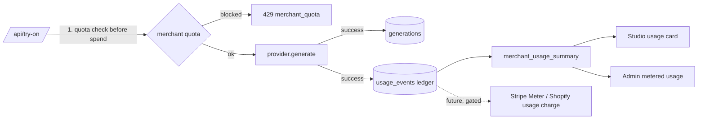

# Usage Metering, Billing Architecture & Corrected Unit Economics

> **Status: metering and quotas are built. Billing is NOT live, by design.** No payment provider code exists. `BILLING_MODE` accepts only `disabled` (default) or `shadow`. `live` is rejected by `npm run check:env`, by `lib/billing.ts`, and by a live-Stripe-key check. Turning billing on requires a reviewed release (see the GATE rows in `14-production-readiness-audit.md`).

## 1. What is built

| Component | Where | Behaviour |
|---|---|---|
| `plans` | `0004_usage_billing.sql` | pilot (free, 500/mo hard cap), starter $49/250 (+$0.15), growth $149/1,000 (+$0.15), pro $399/3,000 (+$0.12), enterprise (custom). Every row has `is_test_price = true`. |
| Merchant plan & quota | `merchants.plan`, `monthly_generation_quota` (override), `billing_status` | **Server-only** (column grants; integration-tested) |
| Quota enforcement | `lib/limits.ts` → `runTryOn` | Counts `pending + succeeded` generations this UTC month. Blocks **before** any provider call on hard-capped plans or suspended merchants. |
| Usage ledger | `usage_events` | One row per successful generation (`unique(generation_id)`). Append-only trigger. Only `reported_to_billing_at` may change, and only via the service role. Stores the provider cost estimate (COGS), not the price. |
| Invoice estimate | `merchant_usage_summary()` + `lib/billing.ts#estimateInvoice` | Base price plus overage (none on hard-capped plans) |
| Margin model | `lib/billing.ts#grossMargin` | AI cost + card fees + billing-platform fee + app-store revenue share + infrastructure allocation |

## 2. Target billing design (not built)

**Option A: Stripe Billing (direct merchants, custom sites)**
- A Customer per merchant. A Subscription with a flat base price plus a **metered price** tied to a Stripe Billing Meter.
- A daily job sends `usage_events` where `reported_to_billing_at is null` to the meter, with an idempotency key of `generation_id`, then stamps `reported_to_billing_at`.
- Webhooks (`invoice.paid`, `invoice.payment_failed`, `customer.subscription.updated`) update `merchants.billing_status`. `past_due` becomes a soft block after a grace period.
- Pricing (third-party sources, **verify on stripe.com**): card processing ~2.9% + $0.30 (US); Stripe Billing pay-as-you-go ~0.7% of billing volume. Stripe completed its Metronome acquisition on 14 Jan 2026, and advanced usage billing is routed there.

**Option B: Shopify Billing API (merchants who install via the Shopify App Store)**
- App subscriptions with a capped usage line item. Shopify collects payment on the merchant's Shopify invoice.
- App Store distribution generally requires Shopify Billing for charges to Shopify merchants. Verify the current policy.
- **Revenue share** (Shopify changelog, effective 16 Jun 2025): **0% on the first $1M USD of lifetime revenue**, 15% above. Earnings before 1 Jan 2025 don't count.

**Shadow mode first:** with `BILLING_MODE=shadow`, compute monthly estimated invoices and compare them with `merchant_usage_summary` before any real charge. Then run a Stripe **test-mode** dry run (backlog P2-1).

## 3. Corrected unit economics

All values are estimates. COGS = AI cost × billable generations + card fees (2.9% + $0.30) + billing platform (0.7%) + $2 infrastructure per merchant. Figures come from the same formula as `lib/billing.ts`.

### Gross margin by tier, utilization and AI cost (revenue share 0%, the first $1M)

| Tier | Utilization of allowance | AI $0.075 (FASHN on-demand) | AI $0.049 (FASHN Tier III) |
|---|---|---|---|
| Starter $49 / 250 | 50% | 73% | 79% |
| | 100% | 53% | 67% |
| | 200% (overage at $0.15) | 50% | 65% |
| Growth $149 / 1,000 | 50% | 70% | 78% |
| | 100% | **45%** | 62% |
| | 200% | **45%** | 63% |
| Pro $399 / 3,000 | 50% | 68% | 77% |
| | 100% | **39%** | 59% |
| | 200% (overage at $0.12) | **37%** | 57% |

**Above $1M lifetime Shopify revenue** (15% revenue share), subtract about 15 points. Pro at 100% on-demand cost falls to **24%**.

### What changed versus the earlier model, and what to do

1. **Billing-platform and app-store fees were missing.** They cost 0.7–15.7 points of margin.
2. **Pro and Growth miss the ≥60% gate (G8) at full use on on-demand AI pricing.** Required before selling them:
   - move to a FASHN commitment tier (≤ $0.049) once volume exceeds about 4,000 images a month;
   - raise Pro overage from $0.12 to at least $0.15;
   - or cut Pro's allowance to 2,500.
3. **The pilot is a pure cost.** At most 500 × $0.075 = **$37.50 per merchant-month**, about **$280** for 5 merchants over 6 weeks. The daily global budget cap (default $20) bounds runaway spend.
4. **Failed generations** are logged at $0 because FASHN documents no charge for failures. Reconcile against the real invoice monthly. If they diverge, the cost estimate in `FASHN_COST_PER_IMAGE_USD` is wrong.
5. **Measured cost replaces assumptions** once live: `generation_stats_daily.cost_per_success_usd` and the ledger give real COGS per merchant. Update this table from those numbers after P1-1.

## 4. Stop conditions

- No code path calls a payment API.
- `BILLING_MODE=live` or an `sk_live_` key makes `check:env` fail. `billingMode()` throws.
- `merchants.billing_status` defaults to `not_billing`. Studio states "No charges are made by this version of TrendSet."
