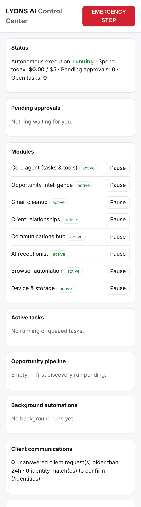

# LYONS AI — Architecture

LYONS AI is a self-hosted agent that acts as a chief of staff for Lyons Cleaning Solutions LLC and its owner. You control it from Telegram on your iPhone. It reasons with Claude, keeps state in PostgreSQL, gets its scheduled triggers from n8n, and acts only through a fixed set of permissioned tools.

## System diagram

```
 iPhone (Telegram)                                    Internet
       │  long-polling (no inbound port)                 │
       ▼                                                 ▼
┌──────────────────────────── VM / container host ──────────────────────────────┐
│                                                                                │
│  ┌──────────────┐   OAuth callback only   ┌──────────────────────────────────┐ │
│  │ Caddy (TLS)  │ ──────────────────────▶ │ lyons-ai (Node 22 / TypeScript)  │ │
│  └──────────────┘                         │                                  │ │
│                                           │  Telegram bot (grammY)           │ │
│  ┌──────────────┐  signed webhooks        │  HTTP: /healthz /oauth /hooks/*  │ │
│  │ n8n          │ ──────────────────────▶ │  Worker ─▶ TaskRunner (agent loop)│ │
│  │ cron/events  │   HMAC + timestamp      │     │        │                    │ │
│  └──────────────┘                         │     │        ├─ Policy engine     │ │
│                                           │     │        ├─ Tool registry     │ │
│  ┌──────────────┐                         │     │        └─ Agent registry    │ │
│  │ PostgreSQL   │ ◀────────────────────── │  Store (all SQL)                  │ │
│  │ tasks, memory│                         │                                  │ │
│  │ audit, tokens│                         │  Tools: Gmail · Calendar · Memory │ │
│  └──────────────┘                         │         StayOps (RO) · Browser   │ │
│                                           └──────────────────────────────────┘ │
└────────────────────────────────────────────────────────────────────────────────┘
          │ HTTPS out: api.anthropic.com, Google APIs, StayOps API, allowlisted sites
```

## Request lifecycle

1. **Intake.** A Telegram message, a `/brief` command, or a signed n8n webhook creates a row in `tasks` (`queued`). Each task has a **scope** (`business` or `personal`), which picks the accounts it can touch, and an **agent**, which picks its instructions and tool allowlist.
2. **Claim.** The `Worker` polls Postgres and claims a task with `FOR UPDATE SKIP LOCKED` plus a 60-second lease that it renews while working.
3. **Agent loop.** `TaskRunner` replays the task's transcript from `task_messages`, calls Claude (Opus 5.5, adaptive thinking, cached system prompt and transcript), and stores the full response **append-only**.
4. **Tool calls.** Each `tool_use` is inserted once, keyed by its `tool_use_id`. The **policy engine** then classifies it by the tool's declared risk:
   - `read` / `write_internal`: runs immediately.
   - `external_communication`, `financial`, `destructive`, `permissions`, `legal`: the task moves to `awaiting_approval` and Telegram shows the exact action with Approve and Reject buttons.
   - Wrong scope, or the kill switch is on: denied.
5. **Approval.** Your decision is written in one transaction. The task is re-queued, and the runner resumes from the stored transcript. Rejected or expired actions go back to Claude as errors, and the prompt tells it not to retry them.
6. **Completion.** Claude's final text is sent to Telegram. Cost, every tool call, and every state change are recorded in `spend_ledger`, `tool_calls`, and `audit_log` (append-only, enforced by a trigger).

## Safe resume (no duplicate actions)

| Crash point | What happens on resume |
|---|---|
| Before the model's reply was stored | The model is called again for that turn. No side effects happened. |
| After the reply was stored, before tools ran | Tools run. The model isn't called again for that turn. |
| A tool finished (`succeeded`/`failed`) | Its stored result is reused. It never runs again. |
| A tool was mid-execution (`running`) | **Idempotent** tools (reads; calendar insert with a deterministic event id) run again. **Non-idempotent** tools are marked `outcome_unknown`, aren't retried, and you get a "please verify" message. |
| Two workers race for the same call | `markToolCallRunning` is a conditional update, so only one wins. |

The integration tests cover each of these rows (`test/integration/runner.test.ts`).

## Extensibility: adding specialist agents and tools

- **New agent.** Add an `AgentDefinition` in `src/agents/index.ts` with a name, instructions, and a tool allowlist. Telegram routes to it with `/agent <name> …` and n8n with `"agent": "<name>"`. The runner, policy, approvals, budgets, and audit apply automatically.
- **New tool.** Implement `ToolDefinition` with a zod input schema, a `risk`, `idempotent`, `describeAction`, and `run`, then register it in `buildTools()` (`src/app.ts`). Its risk class alone decides whether it needs approval; the model can't change that.
- **New channel** (e.g. SMS or a web dashboard). Implement the `Notifier` interface and an intake that calls `store.createTask`.
- **Future multi-agent delegation.** `tasks.parent_task_id` already exists, so a `delegate_task` tool can create child tasks for specialist agents without schema changes.

## Key design decisions

- **Manual agent loop** (not the SDK tool runner). Approvals need to pause for hours, survive restarts, and resume. That requires the loop's state to live in Postgres, not in process memory.
- **Policy outside the model.** Whether an action needs approval is a property of the tool, not something Claude decides. Prompt injection can at most *propose* an action, which you then see verbatim.
- **Account selection by task scope, not by the model.** The model can't choose to act in the personal account during a business task.
- **Long-polling Telegram.** No inbound port and no webhook secret to manage. The only public endpoint is the OAuth callback.
- **Read-only StayOps and browser.** These are the highest-risk surfaces until their contracts are verified (see `STAYOPS_INTEGRATION.md`).

## Source map

| Path | Purpose |
|---|---|
| `src/core/runner.ts` | Agent loop, approvals, resume, budgets, timeouts, kill-switch checkpoints |
| `src/core/policy.ts` | Deterministic allow / approve / deny |
| `src/core/registry.ts`, `src/agents/` | Tool and agent registries |
| `src/core/llm.ts` | Claude client (Opus 5.5, adaptive thinking, caching, refusal fallbacks) |
| `src/db/store.ts`, `migrations/` | All SQL; schema |
| `src/security/` | AES-256-GCM secret box, untrusted-content wrapping, webhook HMAC |
| `src/integrations/google/` | OAuth (encrypted tokens), Gmail read/draft, Calendar read/conflicts/create |
| `src/integrations/browser/` | Isolated read-only page-snapshot workflow (Playwright) |
| `src/integrations/stayops/` | Read-only StayOps adapter (proposed contract) |
| `src/telegram/` | Bot commands, approval buttons, owner-only guard |
| `src/http/server.ts` | Health, OAuth callback, signed n8n hooks |
| `deploy/` | Caddy, Postgres init, n8n workflow |

## Expansion modules (v0.2)

All modules plug into the same core: tools with risk classes, the policy engine, approvals, the audit log, budgets, and the kill switch. Each also has its own **module pause** and declares **data classes**.

| Module | Code | Docs |
|---|---|---|
| Opportunity Intelligence | `src/opportunities/` (sources, assess, scheduler, service) | `OPPORTUNITIES.md` |
| Control Center dashboard | `src/http/control-center.ts`, `src/http/sections.ts` | below |
| Gmail Intelligence & Cleanup | `src/gmail-cleanup/` | `COMMUNICATIONS.md` |
| Client relationships + communications hub | `src/clients/`, `src/comms/imessage-bridge.ts` | `COMMUNICATIONS.md` |
| AI receptionist | `src/receptionist/` | `RECEPTIONIST.md` |
| Apple device & storage | `src/device/storage.ts`, `deploy/macos-bridge/` | `APPLE_AND_DEVICE.md` |

### Module pauses and data classes
- `MODULES` (`src/core/types.ts`): `core_agent, opportunities, gmail_cleanup, client_relationships, communications, receptionist, browser, device_storage`. Pausing one denies its tools in the policy engine and stops its background jobs and bridge queues. The global kill switch stops everything.
- `DATA_CLASSES`: `public, business_internal, client_pii, personal_messages, personal, financial`. Tools declare what they expose and agents declare what they may see. A tool outside an agent's classes is hidden from the model **and** denied by policy if called anyway. The `software_engineer` agent only gets `public` and `business_internal`, so coding work never sees client records, messages or personal data unless you add those classes explicitly.

### Automation policies
`automation_policies` + `tool.autoApprove()`: an approval-gated send can skip per-message approval only if an **owner-activated** policy covers that exact channel, recipient, subject prefix and hours, under a daily cap. Activation is Telegram/owner-only; no model tool exists for it.

### Control Center
`/control` on the private port (reach it by SSH tunnel or Tailscale). It has token sign-in, a signed HttpOnly SameSite=Strict session bound to the token, CSRF on every action, and HTML-escaping of all third-party text. It shows: emergency stop, module pauses, pending approvals, active tasks, the opportunity pipeline, background job runs, client communications, automation policies, Gmail cleanup plans, storage recommendations, receptionist calls, and the action log. `/control/api/state` serves JSON for a future Telegram Mini App.


